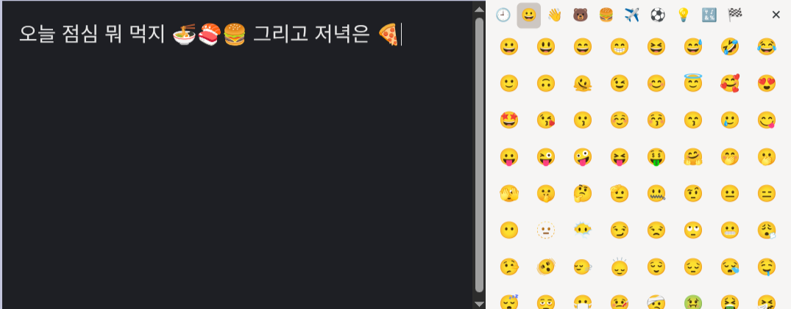
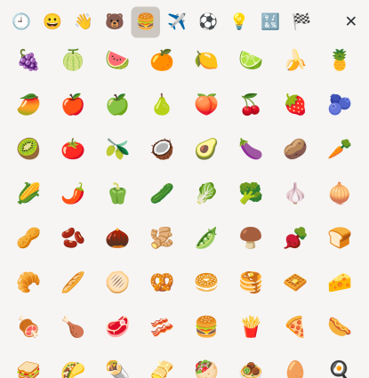
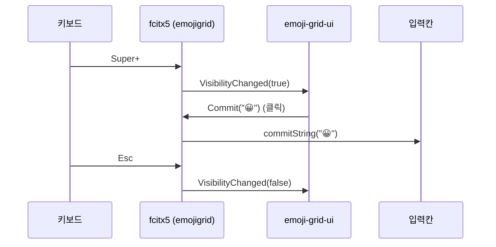

# fcitx5-emoji-grid

Windows `Win+;` 이모지 패널처럼 쓰는 Wayland용 이모지 그리드 선택기입니다.

- `Super+;`로 열고 이모지를 클릭하면 입력칸에 바로 들어갑니다.
- 창이 열린 채로 여러 개를 연달아 고를 수 있습니다. 닫을 때는 `Esc`를 누르거나 `✕`를 클릭합니다.
- 입력칸 포커스가 옮겨 가지 않습니다. 입력은 fcitx5 입력기를 거치므로 클립보드도 바뀌지 않습니다.



| 음식 탭 | 국기 탭 |
|---|---|
|  |  |

## 동작 방식

두 부분으로 나뉩니다.

| 구성 | 하는 일 |
|---|---|
| `emojigrid` (fcitx5 애드온, C++) | `Super+;`로 창을 열고 닫습니다. 창이 열려 있으면 `Esc`로 닫습니다. D-Bus `Commit`으로 받은 문자열을 입력기 경로(`commitString`)로 입력칸에 넣습니다. |
| `emoji-grid-ui` (Python GTK4) | 키보드를 가져가지 않는 layer-shell 창에 그리드를 그립니다. 클릭한 이모지를 애드온에 보냅니다. |



D-Bus 인터페이스는 `org.fcitx.Fcitx5`의 `/emojigrid` 경로에 있는 `org.fcitx.Fcitx.EmojiGrid1`입니다.

| 이름 | 종류 | 설명 |
|---|---|---|
| `Commit(s)` | 메서드 | 문자열을 가장 최근 입력칸에 입력 |
| `Hide()` | 메서드 | 창 닫기 |
| `IsOpen() → b` | 메서드 | 창이 열려 있는지 |
| `VisibilityChanged(b)` | 신호 | 창 열림/닫힘 |

## 필요한 것

- Wayland 컴포지터. layer-shell과 입력기 프로토콜(`zwp_input_method_v2`)을 지원해야 합니다. niri에서 확인했습니다.
- fcitx5 5.1. 앱이 fcitx5에 연결돼 있어야 합니다(Wayland 입력기, `GTK_IM_MODULE`/`QT_IM_MODULE` 등).
- Nix(flake).

## 설치 (Nix, sudo 없이)

1. 시스템 nixpkgs 리비전을 확인합니다. 애드온은 실행 중인 fcitx5와 같은 빌드에 링크돼야 읽힙니다. `flake.nix`는 `c59305b`로 고정돼 있습니다.
   ```sh
   jq -r .nodes.nixpkgs.locked.rev /etc/nixos/flake.lock
   ```
2. 그 리비전으로 nixpkgs를 바꿔서 사용자 프로필에 설치합니다. `<rev>`에 1번 결과를 넣습니다.
   ```sh
   nix profile add github:Camof1ow/fcitx5-emoji-grid --override-input nixpkgs github:NixOS/nixpkgs/<rev>
   ```
3. fcitx5가 애드온을 찾도록 설정 파일을 연결합니다. 설정 파일의 `Library=`가 절대경로라서 `FCITX_ADDON_DIRS`를 고칠 필요가 없습니다.
   ```sh
   mkdir -p ~/.local/share/fcitx5/addon
   ln -sfn ~/.nix-profile/share/fcitx5/addon/emojigrid.conf ~/.local/share/fcitx5/addon/
   ```
4. fcitx5 기본 Quick Phrase도 `Super+;`를 씁니다. `~/.config/fcitx5/conf/quickphrase.conf`에서 Quick Phrase 단축키를 바꿉니다.
   ```ini
   [TriggerKey]
   0=Super+grave
   ```
5. 그리드 창을 user 서비스로 띄웁니다. `~/.config/systemd/user/emoji-grid.service`:
   ```ini
   [Unit]
   After=graphical-session.target
   PartOf=graphical-session.target

   [Service]
   ExecStart=%h/.nix-profile/bin/emoji-grid-ui
   Restart=on-failure

   [Install]
   WantedBy=graphical-session.target
   ```
   ```sh
   systemctl --user enable --now emoji-grid.service
   ```
6. fcitx5를 재시작합니다.
   ```sh
   fcitx5 -r -d
   ```
7. 컴포지터가 `Super+;`를 먼저 가로채지 않는지 확인합니다. 컴포지터 단축키로 잡혀 있으면 fcitx5까지 오지 않습니다.

## 업데이트할 때

시스템 nixpkgs를 올렸다면 새 리비전으로 다시 설치하고 fcitx5를 재시작합니다.

```sh
nix profile remove fcitx5-emoji-grid
nix profile add github:Camof1ow/fcitx5-emoji-grid --override-input nixpkgs github:NixOS/nixpkgs/<새 rev>
fcitx5 -r -d
```

## 알아둘 것

- 검색은 없습니다. 그리드 창이 키보드를 가져가지 않기 때문입니다. 대신 최근 사용 탭과 카테고리 탭 9개가 있습니다.
- 피부색 변형 이모지는 뺐습니다.
- 최근 사용 목록은 `~/.local/state/emoji-grid/recent.json`에 저장됩니다(최대 36개).
- 창 위치는 화면 오른쪽 아래로 고정입니다.
- `flake.nix`는 `aarch64-linux`와 `x86_64-linux`를 정의합니다.
- 이모지 데이터는 nixpkgs `unicode-emoji`의 `emoji-test.txt`를 씁니다.
